# 脉动智能产线数字孪生调度指挥中心 · 交互原型

> 中建四局模块建筑科技公司 ｜ 13:4（1920×590）超宽指挥中心大屏交互原型
> 单文件 HTML · 零第三方依赖 · 双击即可运行

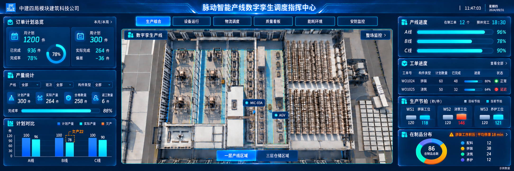

---

## 项目简介

面向模块建筑智能产线的**数字孪生调度指挥中心大屏**高保真交互原型。以 1F 产线三维场景为视觉中心，左右两侧承载业务数据，覆盖"工位—计划—设备—物流—质量—能耗—安防"全链路生产运营视角，用于方案汇报、需求评审与前端开发交底。默认进入**工作站首页**，顶部导航可切换六大业务看板。

原型基于 Axure 交互稿（`HTML/13_4指挥中心【有交互】.html`）重制，修复了原稿"场景切换不联动、页签无法切换、图表为静态图片"等问题，全部图表改为实时渲染的内联 SVG，所有卡片数据随看板与楼层联动。

- **设计尺寸**：1920 × 590（13:4），JS 按窗口等比缩放，适配任意分辨率大屏
- **版式结构**：左栏 23% ｜ 中心模型区 53% ｜ 右栏 23%
- **视觉体系**：深海蓝主题（主色 `#2EA3FF`），语义色编码运行/预警/告警/离线状态

## 界面预览

| 生产综合 | 设备运行 |
| :---: | :---: |
|  | 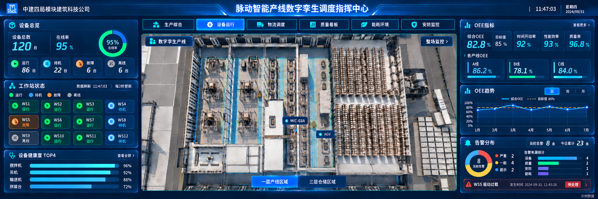 |

| 物流调度 | 质量看板 |
| :---: | :---: |
| 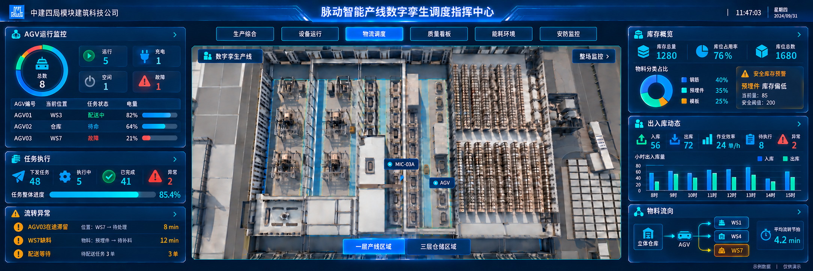 | 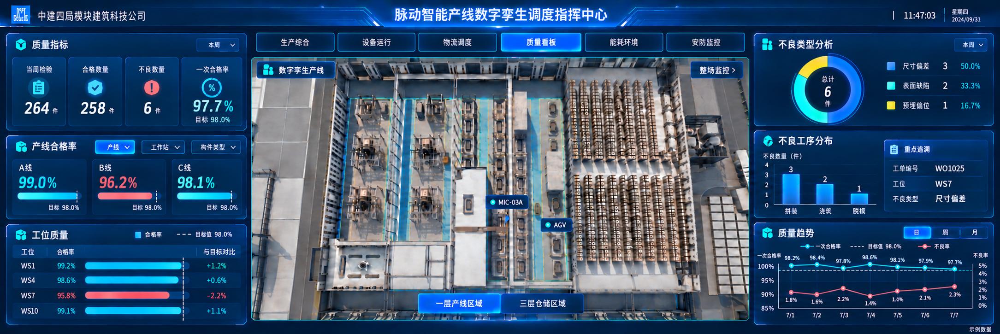 |

| 能耗环境 | 安防监控 |
| :---: | :---: |
| 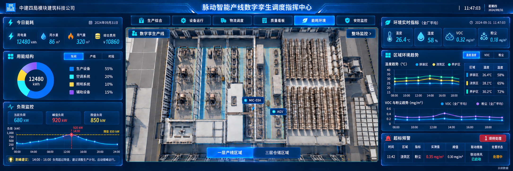 | 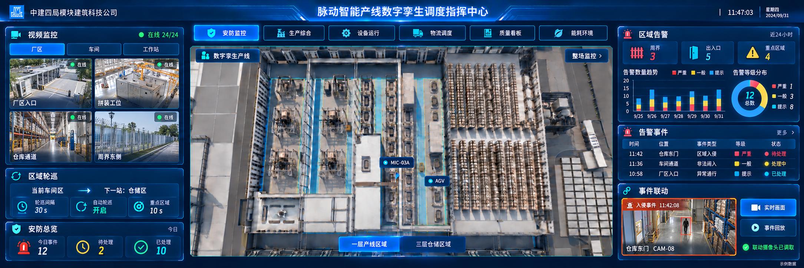 |

**生产详情弹窗 · 五个统计页签**

| 任务详情 | 设备详情 |
| :---: | :---: |
| 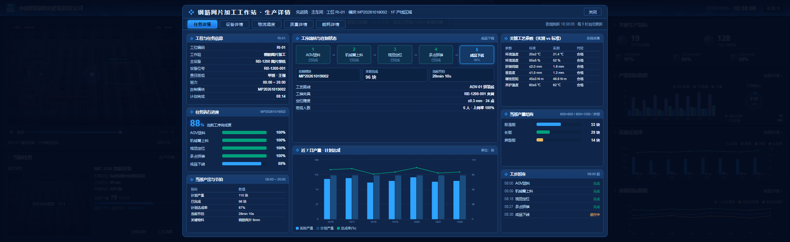 | 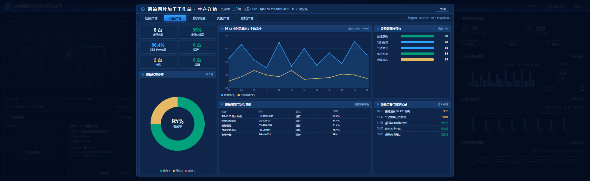 |

| 物流调度 | 质量详情 | 能耗详情 |
| :---: | :---: | :---: |
| 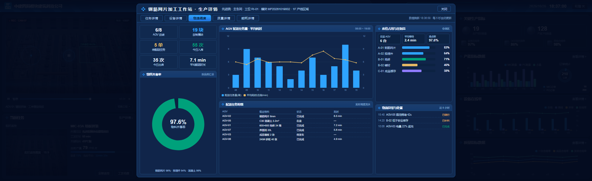 | 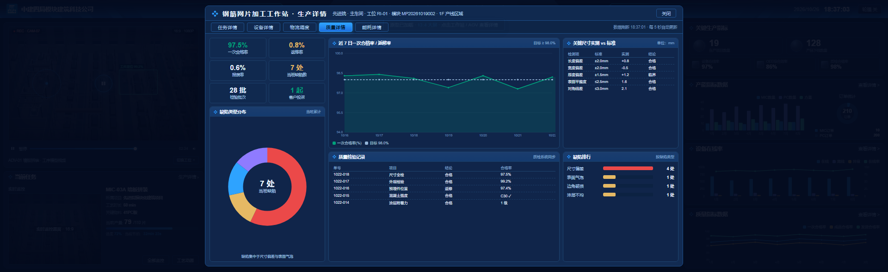 | 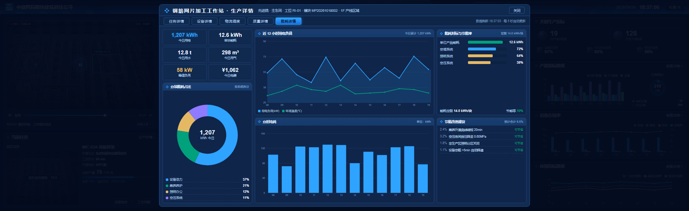 |

## 功能一览

### 一、工作站首页（默认打开）

原型启动即进入「工作站」页，聚焦单工位的工序模拟、实时画面与当前任务：

**左栏**

- **工序模拟视频**：以产线三维场景同源画面作为"机位"底图，叠加取景环、工件定位框、扫描线与 REC / 16:9 标识；底部为播放控制条（播放/暂停、进度轨道可点击定位、时间码、音量），说明行显示当前工位（如 `ADV-01 墙板拼装 · 工序模型视频`）
- **工位切换**：说明行右侧「切换工位 ▾」浮层，按 1F 12 个工位（01–12）切换，状态点区分运行 / 待机 / 故障 / 离线；切换后视频画面、机位号、时间码、当前任务同步刷新
- **当前任务**：左侧「实时监控」画面 + 右侧任务信息（任务编号与名称、所属项目、工艺时长、关键物料、当前产量 x/110 片、进度条与当前节拍），底部「全部监控」唤起整场监控、「工艺动画」开启工艺回放

**右栏（固定，不随工位切换）**

- **关键生产指标**：在产项目数量、产品下线数量（大数 + 球体图标），设备在线率 / OEE 综合效率 / 质检合格率（方块图标）
- **产能指标数据**：MIC 数量 / PC 数量 / 方量 8 个月分组柱 + 订单统计环形图与订单明细
- **设备在线率**：在线 / 离线 / 异常分组柱 + 在线率折线（左右双轴）
- **质量指标数据**：一次合格率 / 成品合格率 / 发货合格率 三线趋势

**联动**：左侧切换工位或点击三维场景中的工位标记，左栏两卡同步刷新并高亮该工位标记，右栏统计保持不变。

### 二、六大业务看板（顶部导航切换）

| 看板 | 核心内容 |
| --- | --- |
| 生产综合 | 订单计划总览（本月/次月）、产量统计、计划对比、产线进度、工单进度、生产节拍、在制品分布 |
| 设备运行 | 设备总览（在线率仪表）、工作站状态矩阵（WS01-12）、健康度 TOP4、OEE 指标与趋势、告警分布 |
| 物流调度 | AGV 运行监控、任务执行、流转异常、库存概览（库位占用/安全库存预警）、物料分类占比、出入库动态、物料流向 |
| 质量看板 | 质量指标、产线合格率、工序质量、不良类型分析、不良工序分布、质量趋势（日/周/月双轴曲线） |
| 能耗环境 | 今日能耗、用能结构（车间/产线/时段）、负荷监控、环境实时指标、区域环境趋势（温度湿度/VOC/粉尘）、超标预警 |
| 安防监控 | 视频监控（4 宫格 + 厂区/车间/工作台页签）、区域轮巡、安防总览、区域告警（堆叠柱 + 等级分布）、告警事件、事件联动 |

### 三、数字孪生场景区

- **楼层切换**：1F 产线区域 / 2F 拼装区域 / 3F，模型画面与左右看板数据同步联动
- **场景标记**：12 个工作站 + 6 台 AGV 空间定位标记，状态色实时区分运行 / 待机 / 故障
- **生产详情弹窗**：点击工作站标记打开弹窗，含任务详情 / 设备详情 / 物流调度 / 质量详情 / 能耗详情五个统计页签（详见下节）
- **视角工具**：归位、视角切换（默认/环视/顶视）、图层对象（AGV / 工作站 / 机械臂显隐）

### 四、生产详情弹窗（五个统计页签）

点击三维场景中的工作站标记（或工作站首页「生产详情」按钮）打开弹窗：弹窗宽 **1034px**（= 1920 × 7/13，对应 3520 设计稿的 1896px），居中浮于场景之上、四周露出看板，标题随工位变化，页签栏右侧显示数据刷新时间（每 5 秒更新）。

弹窗内容按 **左 25% ｜ 中 50% ｜ 右 25%** 三列排布：**左列**为工位信息与指标卡，**中列**为主图表与明细流水，**右列**为占比、排行与处置记录。数值按工位自身参数（设备型号、产能、工序进度、节拍）确定性生成，同一工位每次打开结果一致。

| 列 | 任务详情 | 设备详情 | 物流调度 | 质量详情 | 能耗详情 |
| --- | --- | --- | --- | --- | --- |
| 左 25% | 工位与任务信息、任务执行进度（工步完成度） | 6 项设备指标 + 状态分布环形图 | 6 项物流指标 + 物料齐套率 | 6 项质量指标 + 缺陷类型分布 | 6 项能耗指标 + 分项能耗占比 |
| 中 50% | 工序流转与在制状态、近 7 日产量 vs 计划 | 近 12h 负载率/主轴温度、设备清单 | AGV 任务量与耗时、配送任务明细 | 近 7 日合格率（含目标线）、检验记录 | 近 12h 用电负荷、分时电耗 |
| 右 25% | 关键工艺参数实测/标准、当班产量结构、工步时序 | 设备健康度、告警与维护记录 | 库位占用与在制品、物流异常处置 | 关键尺寸实测/标准、缺陷排行 | 能耗对标、节能改造建议 |

各页签主要内容：

- **任务详情**：工序流转泳道（五工步状态高亮）+ 在制模块/本班完成/节拍；任务执行进度条；近 7 日产量与达成率；关键工艺参数（温度、湿度、拼装间隙、垂直度、扭矩、养护温度）实测 vs 标准；当班产量结构与工步时序
- **设备详情**：设备总数/在线率/OEE/运行/待机/故障；状态分布环形图；负载率与主轴温度双线；设备清单（型号、位置、状态、运行时长、OEE）；健康度评分与告警维护流水
- **物流调度**：AGV 在线、在制、待配送、今日出入库、平均配送时长；配送任务量与平均耗时双轴图；物料齐套率；库位占用；配送明细与异常处置
- **质量详情**：一次合格率、返修率、报废率、缺陷数、检验批次、客诉；近 7 日合格率趋势（含 98.0% 目标线）；缺陷类型分布与排行；关键尺寸实测 vs 标准；检验记录
- **能耗详情**：今日用电、单块能耗、用水、用气、峰值负荷、电费；分项能耗占比；近 12h 负荷曲线；分时电耗柱状；能耗对标与节能率；节能改造建议

弹窗支持点击遮罩、`Esc` 或「关闭」按钮退出；重新打开任意工位默认回到「任务详情」页签。

### 五、整场监控弹窗

点击顶部「整场监控」按钮打开全厂视频监控视图：

- **监控设备业务分类树**：视频监控（厂区/车间/仓储/周界）、门禁管理、报警系统、环境监测，共 28 台设备
- **16 路视频墙**：4×4 排列，在线路数带扫描线动效，离线通道置灰；按区域筛选后补"空闲通道"占位
- **联动交互**：点区域节点筛选视频墙，点摄像头节点调取画面并聚焦磁贴，点设备节点查看运行详情
- **实时事件流**：严重/一般/提示三级事件，支持一键"处置"并回写状态
- **区域在线率**：厂区 / 车间 / 仓储 / 周界 在线率进度条

### 六、工艺回放

底部时间轴按"AGV 送料 → 机械臂上料 → 视觉定位 → 多点拼装 → 成品下线"五道工步回放，支持播放/暂停、上一步/下一步、进度拖动与时段选择。

### 七、其他交互

- 顶部实时时钟、轮播模式、工艺回放 / 整场监控入口
- 卡片页签切换（日/周/月、车间/产线/时段、指标切换等），切换时数据与图表同步刷新
- 指标详情抽屉、处置动作 Toast 提示、全屏自适应缩放

## 技术实现

- **零依赖**：单个 HTML 文件，CSS / JS 全部内联，不引用任何 CDN、框架或图表库，离线可用
- **手写 SVG 图表**：柱状图、分组柱、堆叠柱、折线图、双轴折线、环形图、仪表盘、进度条、状态矩阵等全部由 JS 拼接 SVG 实时渲染，支持动画与数据更新
- **等比缩放舞台**：固定 1920×590 设计稿，按 `scale = min(vw/1920, vh/590)` 等比缩放居中，避免大屏分辨率差异导致错位
- **数据驱动渲染**：`MODULES` 描述六大看板的卡片配置，`renderLeft()/renderRight()` 统一调度，新增卡片只需补充配置
- **模拟数据**：全部业务数据由前端 Mock 生成（含楼层联动系数、实时跳动数值），无后端依赖

## 目录结构

```
.
├─ HTML/
│  ├─ 16_指挥中心【交互原型】.html      # 主交付物（交互原型，单文件）
│  ├─ 13_4指挥中心【有交互】.html       # Axure 原始交互稿（参考）
│  ├─ index.html / start.html           # Axure 导出查看入口
│  ├─ images/                           # 原型图片资源（产线模型、弹窗图表、Logo）
│  ├─ resources/ files/ plugins/ data/  # Axure 导出静态资源
├─ 六类数据看板/                         # 六张看板设计稿（PNG）
└─ README.md
```

## 快速开始

1. 直接用 Chrome / Edge 打开 `HTML/16_指挥中心【交互原型】.html`
2. 大屏部署：将 `HTML` 目录上传至任意静态服务器，用浏览器全屏（F11）或 kiosk 模式打开
3. 推荐分辨率：1920×1080 及以上，页面会自动等比缩放至 13:4 舞台

## 说明

- 本项目为**交互原型**，所有数据均为模拟数据，仅用于方案演示与评审，未接入真实业务系统
- 浏览器要求：Chrome / Edge 90+（使用 CSS Grid、Flex 布局与内联 SVG，不支持 IE）
- 设计稿（`六类数据看板/`）用于说明各看板的信息层级与视觉规范
